# nf-arts

## Summary

`nf-arts` is a Nextflow plugin that turns each pipeline run into a piece of generative art.

The plugin records every task of the run: process, start time, duration, peak memory and status. When the run ends, it draws those tasks as an SVG or PNG image. The run's session ID is the random seed, so the same run always gives the same image.

| Radial | Hilbert |
| :---: | :---: |
| 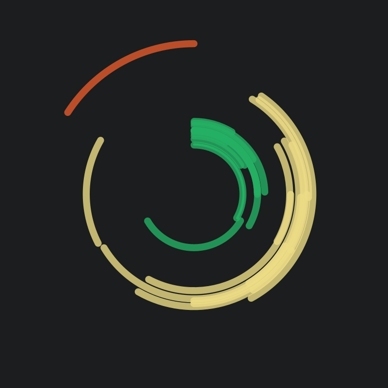 | 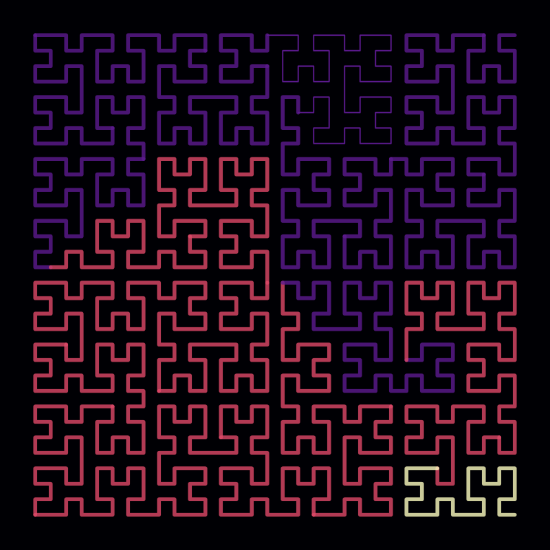 |

Both images come from real runs of the [validation pipeline](validation/main.nf).

## Get Started

Enable the plugin in your pipeline's `nextflow.config`:

```groovy
plugins {
    id 'nf-arts@0.1.0'
}
```

When the run ends, the plugin writes `art-<runName>.svg` to the launch directory.

To add it to a pipeline you don't edit, such as an nf-core pipeline, repeat the pipeline's own plugins. Both `-plugins` and a `plugins {}` block in a `-c` config replace the pipeline's plugins instead of adding to them:

```bash
nextflow run nf-core/rnavar -profile test,docker --outdir results \
    -plugins nf-core-utils@0.4.0,nf-schema@2.6.1,nf-arts@0.1.0
```

### Paint a finished run

`render` paints a run that already finished, from the local history and cache (like [nf-diff](https://github.com/mribeirodantas/nf-diff)) or from an execution trace file:

```bash
# last run in this directory, or pass a run name or session id
nextflow plugin nf-arts:render --style hilbert --file art.png

# any trace file, e.g. an nf-core megatest on S3 (no AWS credentials needed for public buckets)
nextflow plugin nf-arts:render \
    --trace s3://nf-core-awsmegatests/rnavar/results-ea2c7b6286f5ae18f5b51dc0af6b5330ecd6a13a/pipeline_info/execution_trace_2025-12-05_11-13-40.txt \
    --file rnavar.png --palette nfcore
```

It takes the same options as the `arts` scope (`--style`, `--palette`, `--colors a,b,c`, `--background`, `--width`, `--height`, `--file`), plus `--dir` for another project directory. For a local run it uses the same seed as the live plugin, so it gives the same image.

| rnavar megatest, radial | rnavar megatest, hilbert |
| :---: | :---: |
|  |  |

## Examples

```groovy
arts {
    file    = "${params.outdir}/pipeline_info/art.png" // .svg or .png
    style   = 'hilbert'                                 // radial or hilbert
    palette = 'magma'
    width   = 1600
    height  = 1600
}
```

Custom colors:

```groovy
arts {
    colors     = ['#ff006e', '#8338ec', '#3a86ff']
    background = '#ffffff'
}
```

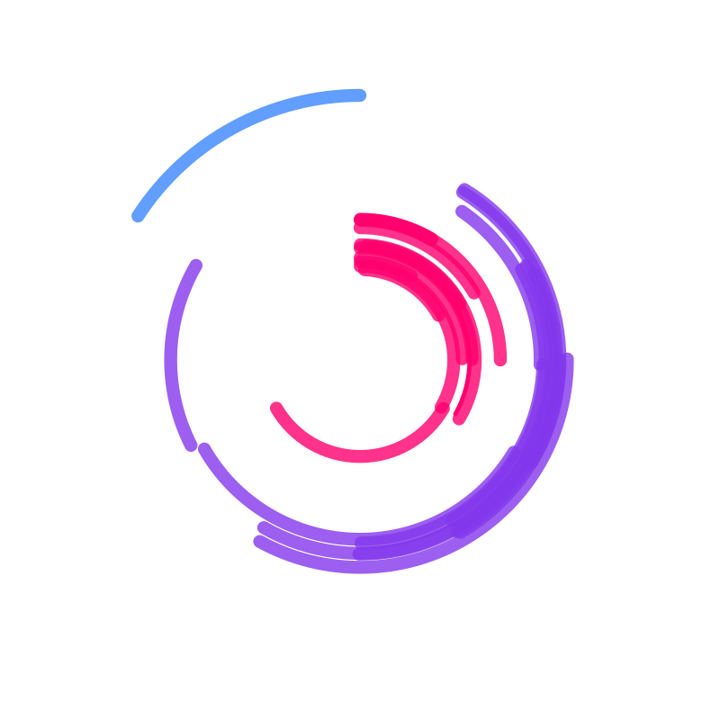

### Options

| Option | Default | Description |
| --- | --- | --- |
| `enabled` | `true` | Create the artwork at the end of the run. |
| `file` | `art-<runName>.svg` | Output file. The `.svg` or `.png` extension sets the format. Cloud paths work too. An existing file is overwritten. |
| `style` | `radial` | `radial` or `hilbert`. |
| `palette` | `viridis` | `viridis`, `magma`, `nfcore`, `ocean`, `sunset` or `mono`. |
| `colors` | | List of hex colors. Overrides `palette`. |
| `background` | from palette | Hex background color. |
| `width`, `height` | `1200` | Size in pixels (16 to 10000). |

### Styles

**radial**: each process is a ring and each task is an arc on its ring. The angle is time: 12 o'clock is the start of the run, and the run goes clockwise. Arc thickness is peak memory.

**hilbert**: tasks are laid end to end, in start order, along a [Hilbert curve](https://en.wikipedia.org/wiki/Hilbert_curve). Each task gets a share of the curve proportional to its duration. Line thickness is peak memory. The curve's resolution grows with the number of tasks. The seed picks one of the 8 orientations of the square.

In both styles, color is the process, cached tasks are faded and failed tasks are thin.

### Gallery

These images come from synthetic runs: 12 to 48 samples through an 8-step alignment and variant-calling pipeline. The `resumed` images show a run where most early steps were cached.

| | | | |
| :---: | :---: | :---: | :---: |
| 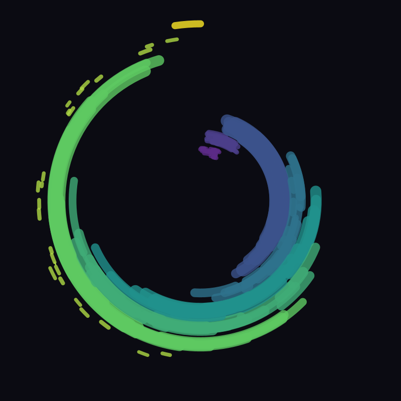 `radial` `viridis` | 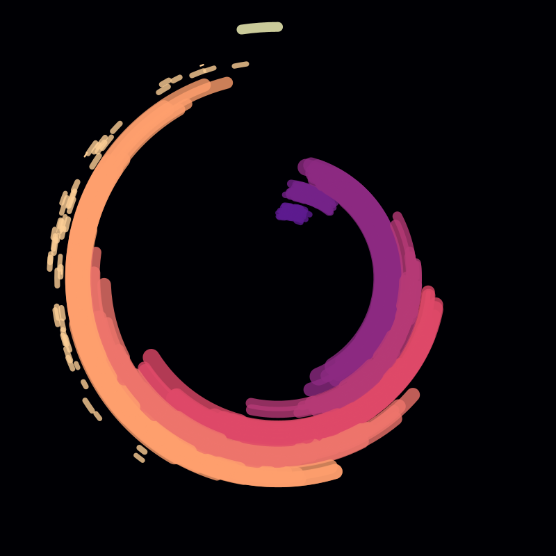 `radial` `magma` | 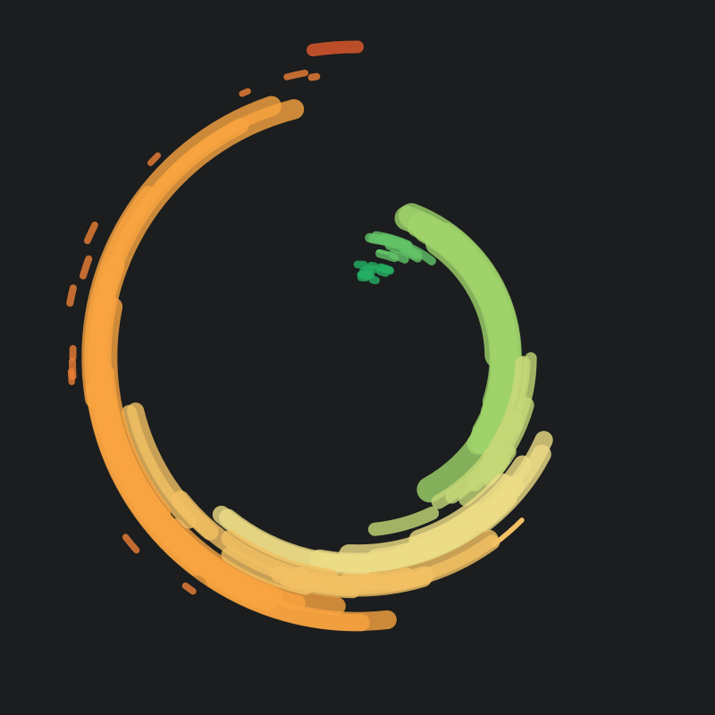 `radial` `nfcore` | 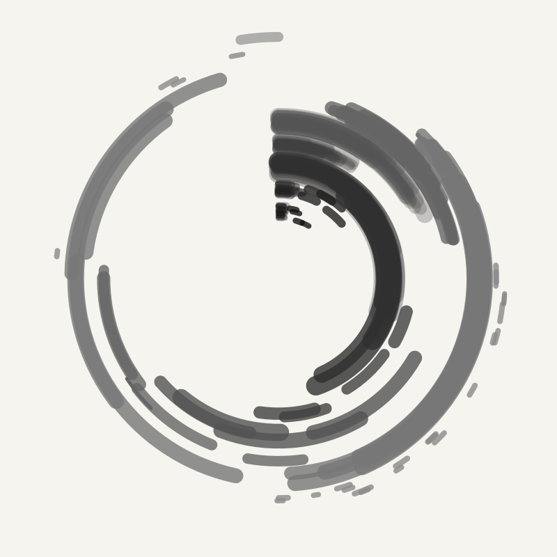 `radial` `mono` resumed |
| 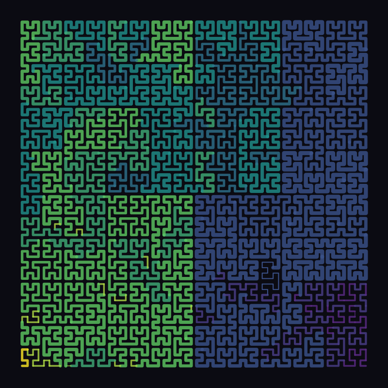 `hilbert` `viridis` | 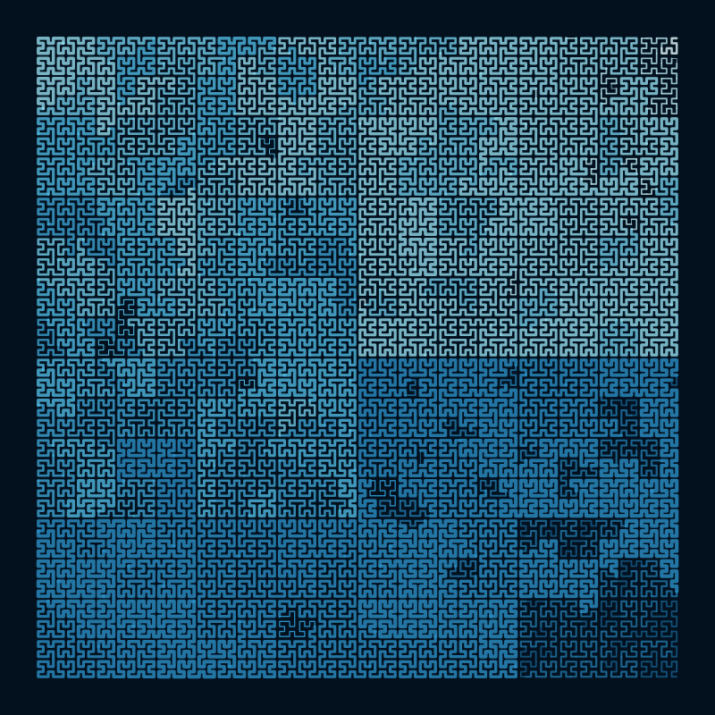 `hilbert` `ocean` | 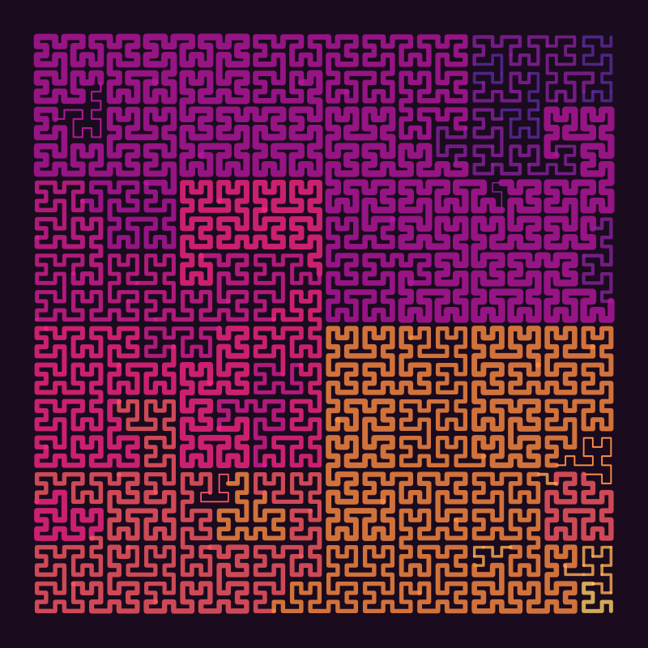 `hilbert` `sunset` | 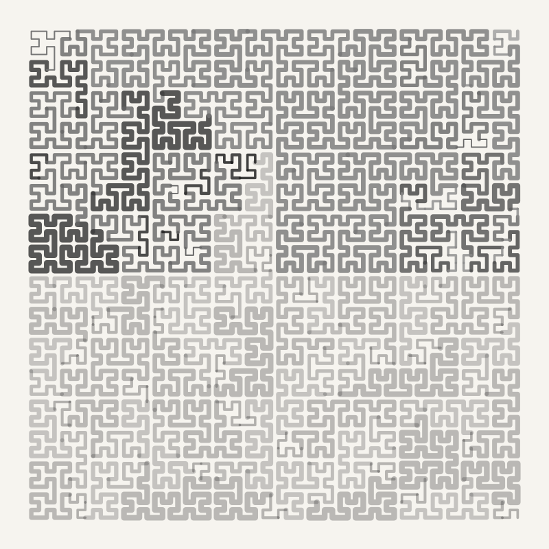 `hilbert` `mono` resumed |

## Plugin development

```bash
make test       # unit tests
make install    # install into ~/.nextflow/plugins
nextflow run validation/ -plugins nf-arts@0.1.0
./gradlew showcase   # regenerate docs/images from synthetic runs
```

`nextflow plugin` only finds a plugin by its bare id, and resolves it from the registry. To try `render` on an unpublished build:

```bash
make dev-repo
export NXF_PLUGINS_TEST_REPOSITORY="file://$PWD/build/plugin-repo/plugins.json"
nextflow plugin nf-arts:render
```

To publish to the Nextflow Registry, copy `.env.example` to `.env`, set `NPR_API_KEY`, then run `make release`.

## License

Apache License 2.0. See the [`COPYING`](COPYING) file for details.
