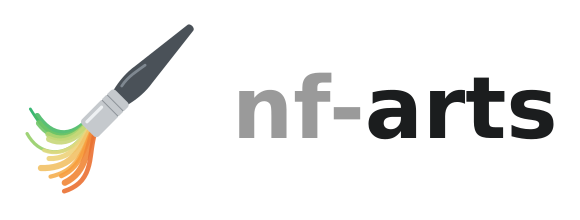

<h1>
  <picture>
    <source media="(prefers-color-scheme: dark)" srcset="docs/images/logo-wordmark-dark.svg">
    
  </picture>
</h1>

## Summary

`nf-arts` is a Nextflow plugin that turns each run into generative art. When the run ends, it draws its tasks as an SVG or PNG, from their timing, memory and status only.

<p>
  
  
  
</p>

## Get Started

Add the plugin to `nextflow.config`:

```groovy
plugins {
    id 'nf-arts@0.1.0'
}
```

The run writes `art-<runName>.svg` to the launch directory. To add nf-arts to a pipeline you don't edit, see [configuration](docs/configuration.md#in-a-pipeline-you-dont-edit).

## Examples

```groovy
arts {
    file  = "${params.outdir}/pipeline_info/art.png"
    style = 'ginkgo'
}
```

Paint a run that already finished:

```bash
nextflow plugin nf-arts:render --style mondrian --file art.png
```

## Documentation

- [Configuration](docs/configuration.md)
- [Styles](docs/styles.md)
- [Paint a finished run](docs/render.md)
- [What goes into the art](docs/data.md)
- [Gallery](docs/gallery.md)
- [Contributing](CONTRIBUTING.md)

## License

MIT, see [`LICENSE`](LICENSE).
