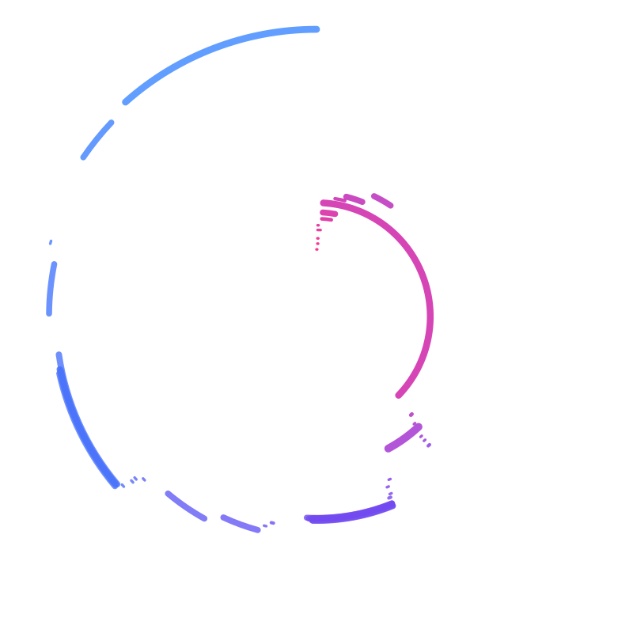

# Configuration

## Enable the plugin

```groovy
plugins {
    id 'nf-arts@1.0.0'
}
```

At the end of the run, nf-arts writes `art-<runName>.svg` to the launch directory.

### In a pipeline you don't edit

`-plugins` and a `plugins {}` block in a `-c` config both replace a pipeline's plugins. List the pipeline's own plugins too, or it fails to start:

```bash
nextflow run nf-core/rnavar -profile test,docker --outdir results \
    -plugins nf-core-utils@0.4.0,nf-schema@2.6.1,nf-arts@1.0.0
```

The pipeline's plugins are in the `plugins` block of its `nextflow.config`.

## The `arts` scope

```groovy
arts {
    file    = "${params.outdir}/pipeline_info/art.png"
    style   = 'hilbert'
    palette = 'magma'
    width   = 1600
    height  = 1600
}
```

| Option | Default | Description |
| --- | --- | --- |
| `enabled` | `true` | Draw the artwork when the run ends. |
| `file` | `art-<runName>.svg` | Output file. `.svg` or `.png` sets the format. Cloud paths work. Overwrites an existing file. |
| `style` | `radial` | One of the [styles](styles.md). |
| `palette` | `viridis` | `viridis`, `magma`, `nfcore`, `ocean`, `sunset`, `mono` or `mondrian`. The mondrian style defaults to `mondrian`. |
| `colors` | | Hex colors (`#rrggbb`), overriding `palette`. |
| `background` | from the palette | Hex background color. |
| `width`, `height` | `1200` | Size in pixels, 16 to 10000. |
| `title` | `true` | The caption: pipeline, version, run name and nf-arts version. See [what goes into the art](data.md#the-caption). |

A bad value stops the run at the start, not at the end.

## Palettes

Every palette but `mondrian` blends its colors from the first process to the last. `mondrian` cycles off-white, red, blue and yellow on black lines, without blending.

Custom colors blend the same way:

```groovy
arts {
    colors     = ['#ff006e', '#8338ec', '#3a86ff']
    background = '#ffffff'
}
```


