# Styles

In every style, color is the process, cached tasks are faded and failed tasks are thinner, smaller, hollow or leafless. The session ID seeds the random choices, so the same tasks and the same nf-arts version give the same SVG. See [Randomness](data.md#randomness).

Each style below shows the same run: the nf-core/rnavar megatest, 553 tasks, with the `nfcore` palette (`mondrian` for the mondrian style). More runs are in the [gallery](gallery.md).

| Style | What it draws | |
| --- | --- | :---: |
| `radial` | Each process is a ring, each task an arc on it. Angle is time, clockwise from 12 o'clock. Thickness is peak memory. | 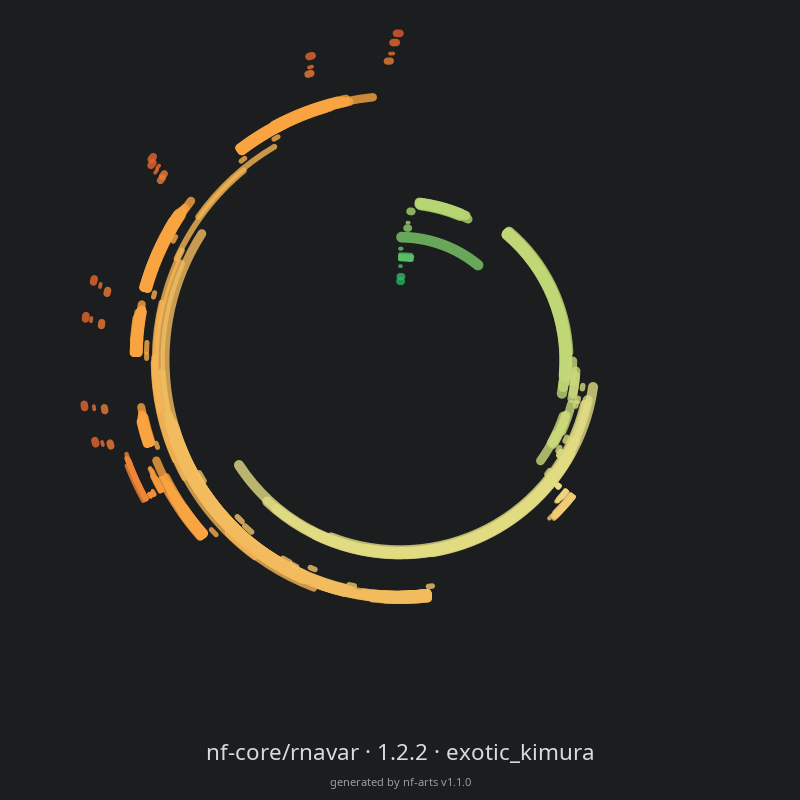 |
| `hilbert` | Tasks run end to end along a [Hilbert curve](https://en.wikipedia.org/wiki/Hilbert_curve) in start order, each taking a share proportional to its duration. Thickness is peak memory. More tasks make a finer curve; the seed picks one of its 8 orientations. | 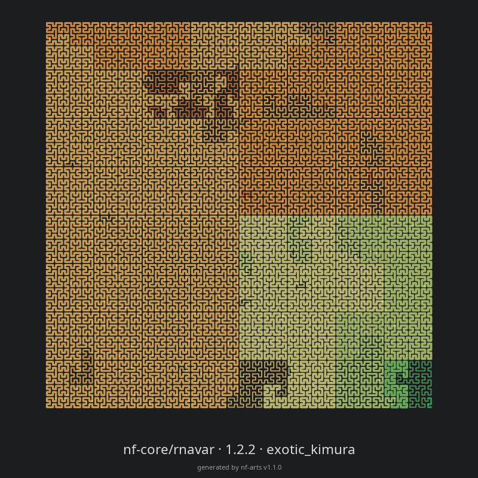 |
| `ridgeline` | One ridge per process, top to bottom, time left to right. Ridge height is how many of the process's tasks were running, relative to its busiest moment. | 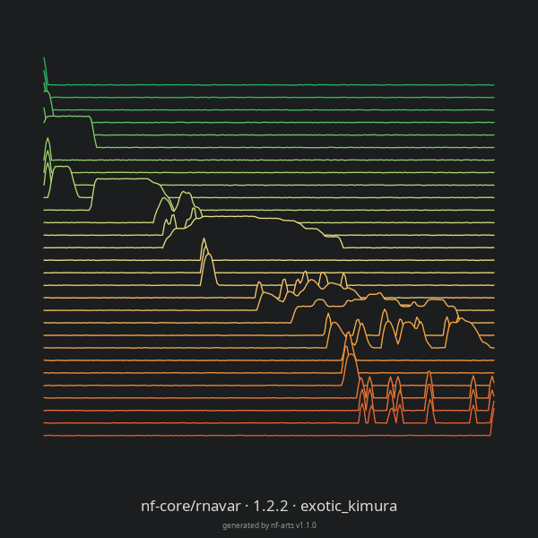 |
| `phyllotaxis` | Tasks are sunflower seeds on a golden-angle spiral, in start order. Dot size is peak memory. | 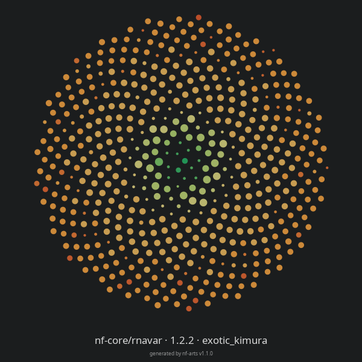 |
| `flowfield` | Each task is a brush stroke drifting through a seeded flow field, starting at its start order (x) in its process's row (y). Length is duration, width is peak memory. | 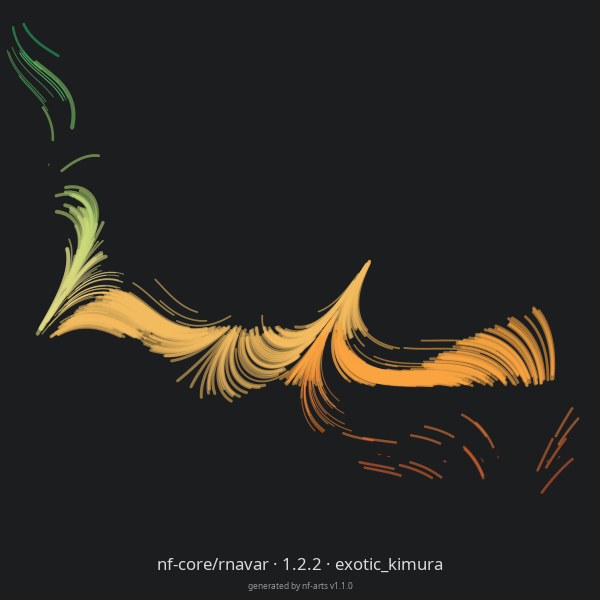 |
| `mondrian` | One block per process, split into one block per task, area proportional to duration. Opacity is peak memory; failed tasks are hollow. Defaults to the `mondrian` palette. | 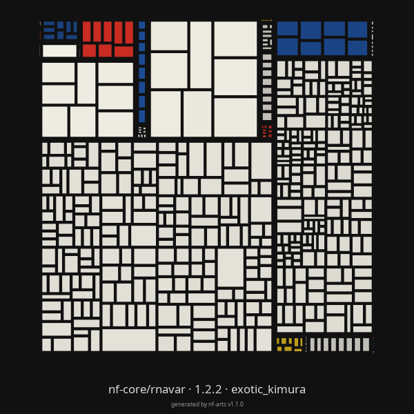 |
| `tree` | The run is the trunk, each process a branch in start order from the bottom. Branch length is how long the process was active. Each task is a twig with a leaf: twig length is duration, leaf size is peak memory. Failed tasks have no leaf. | 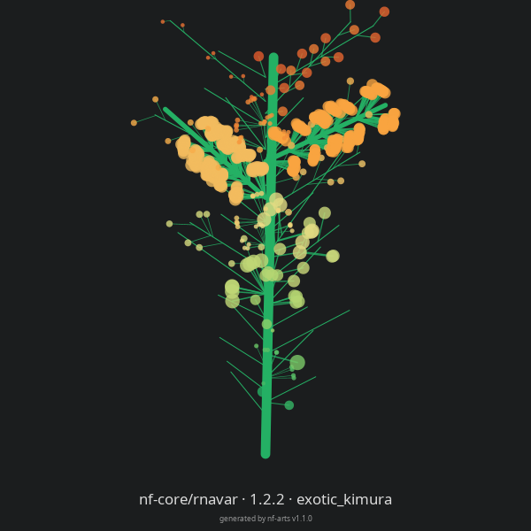 |
| `ginkgo` | The run is one ginkgo leaf. Each task is a vein fanning out from the stem and forking near its tip. Angle is start time, left to right, length is duration, width is peak memory. | 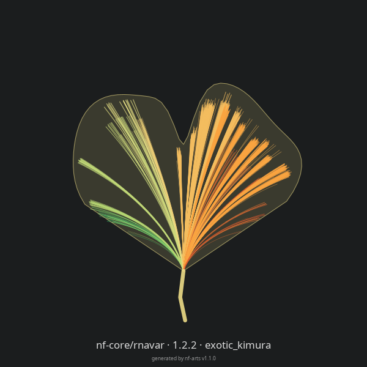 |
| `iris` | The run is the iris of an eye. Each task is a fibre running out from the pupil, in start order, clockwise from 12 o'clock. Length is duration, width is peak memory. The faint ring bulges where long tasks cluster, and the highlight in the pupil sits on the side of the longest task. | 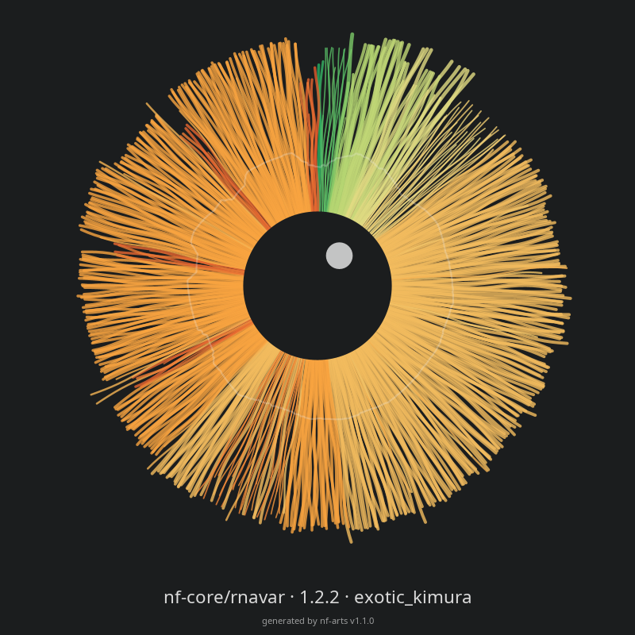 |
| `butterfly` | The run is a butterfly. Processes that start in the first half of the run fill the forewings, the rest the hindwings, each one a cell between two veins, and the wing with more compute time grows. Each task is a stroke in its cell, on both sides: distance from the body is start time, length is duration, width is peak memory. Long processes push the outline out, eyespots mark the hindwing processes with the largest tasks, tails grow when most tasks are far shorter than the longest, and failed tasks bite the wing's edge. | 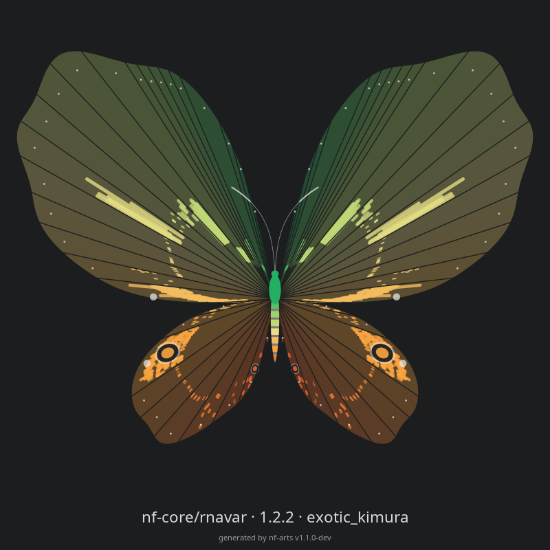 |
| `hive` | A [hive plot](https://www.hiveplot.com/). Each process is a segment of a spoke and each task a dot on it, further out with peak memory. Each task has a curve from the last task that finished before it started on another spoke, so curves show what ran next, not what depends on what. The `spiral` layout deals processes onto the spokes in start order, then one level further out, so the run spirals from the center. The `phase` layout fills one spoke before the next, so each spoke is a stretch of the run. The seed picks the rotation. | 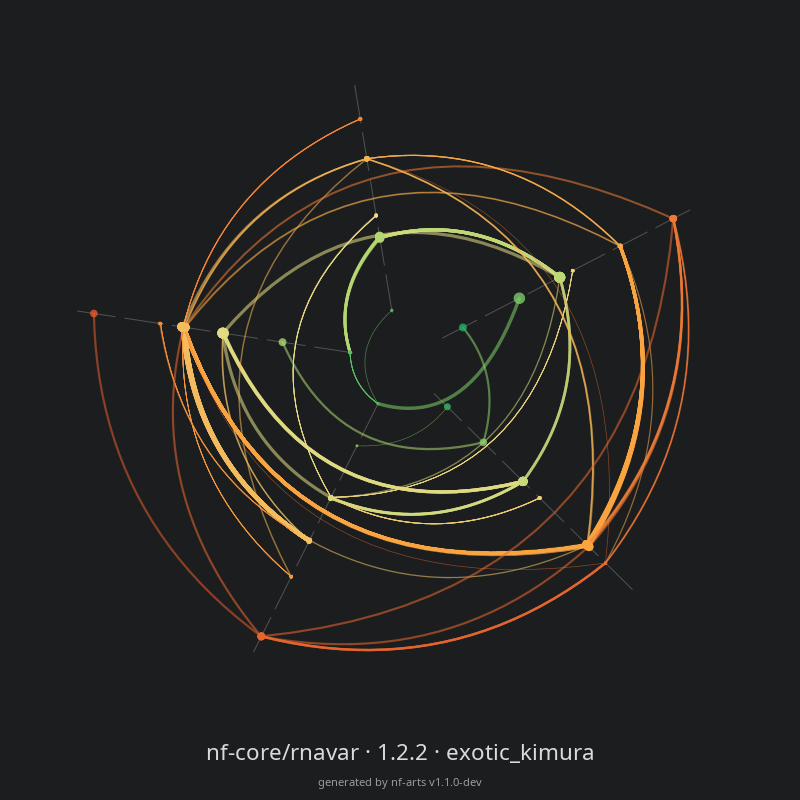 |
