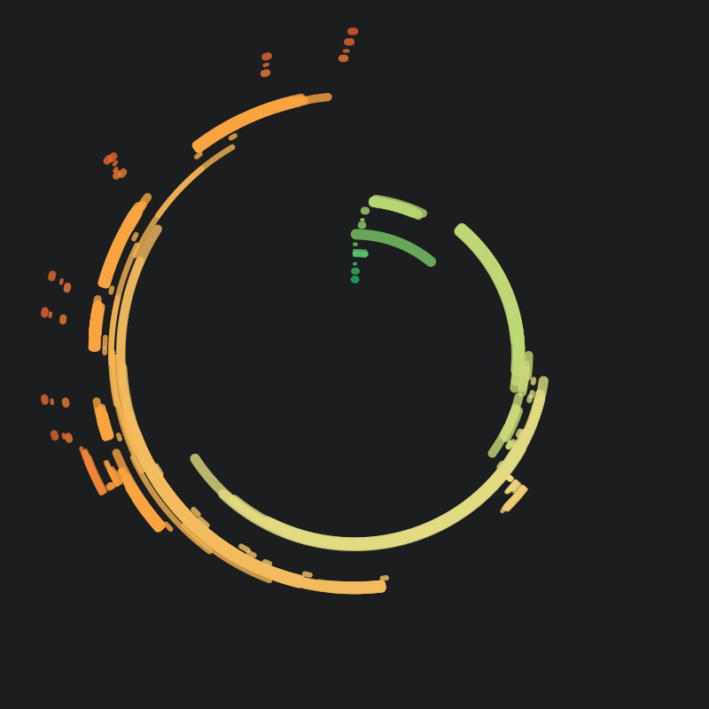
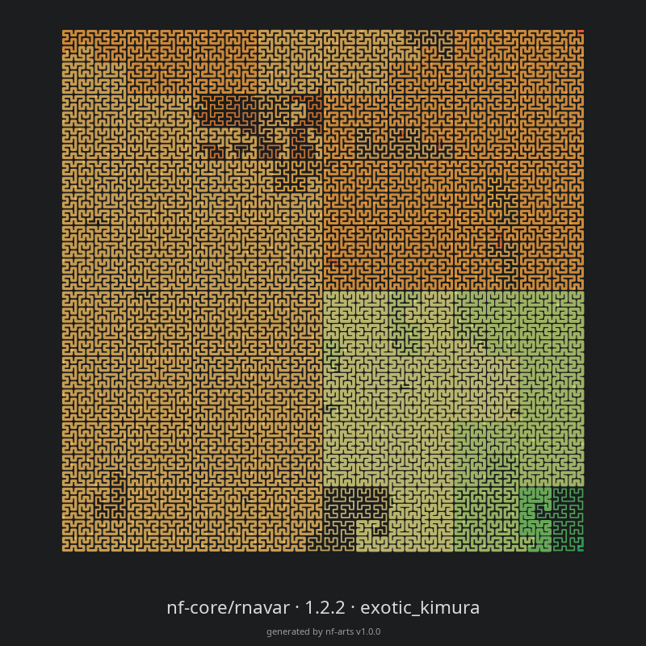
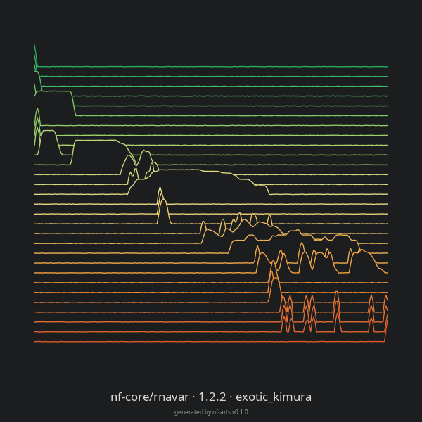
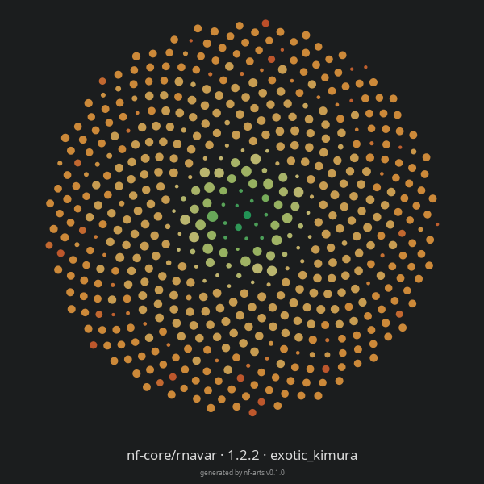
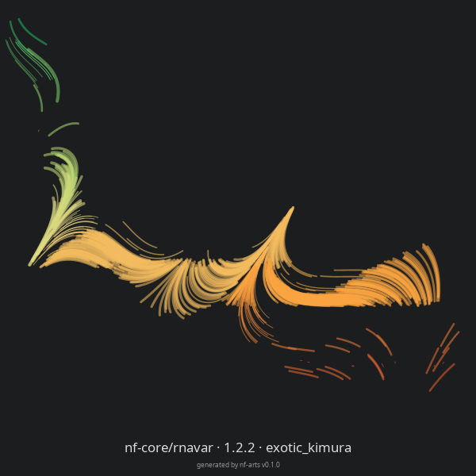
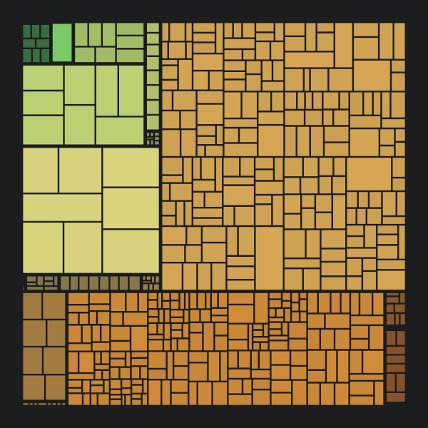
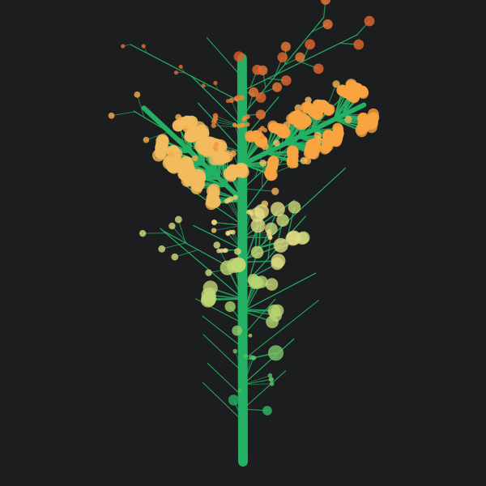
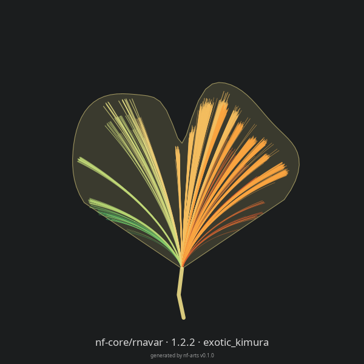
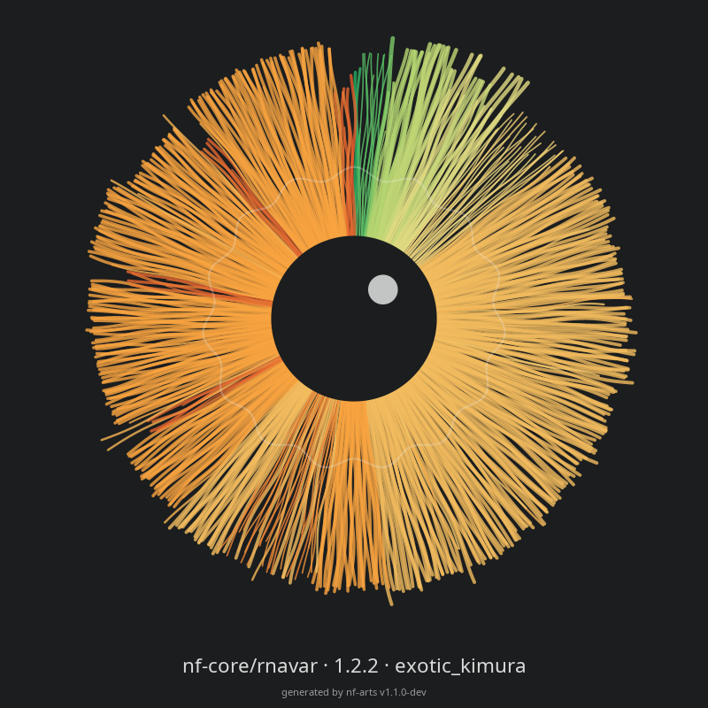

# Styles

In every style, color is the process, cached tasks are faded and failed tasks are thinner, smaller, hollow or leafless. The session ID seeds the random choices, so a run always gives the same image.

Each style below shows the same run: the nf-core/rnavar megatest, 553 tasks, with the `nfcore` palette (`mondrian` for the mondrian style). More runs are in the [gallery](gallery.md).

| Style | What it draws | |
| --- | --- | :---: |
| `radial` | Each process is a ring, each task an arc on it. Angle is time, clockwise from 12 o'clock. Thickness is peak memory. |  |
| `hilbert` | Tasks run end to end along a [Hilbert curve](https://en.wikipedia.org/wiki/Hilbert_curve) in start order, each taking a share proportional to its duration. Thickness is peak memory. More tasks make a finer curve; the seed picks one of its 8 orientations. |  |
| `ridgeline` | One ridge per process, top to bottom, time left to right. Ridge height is how many of the process's tasks were running, relative to its busiest moment. |  |
| `phyllotaxis` | Tasks are sunflower seeds on a golden-angle spiral, in start order. Dot size is peak memory. |  |
| `flowfield` | Each task is a brush stroke drifting through a seeded flow field, starting at its start order (x) in its process's row (y). Length is duration, width is peak memory. |  |
| `mondrian` | One block per process, split into one block per task, area proportional to duration. Opacity is peak memory; failed tasks are hollow. Defaults to the `mondrian` palette. |  |
| `tree` | The run is the trunk, each process a branch in start order from the bottom. Branch length is how long the process was active. Each task is a twig with a leaf: twig length is duration, leaf size is peak memory. Failed tasks have no leaf. |  |
| `ginkgo` | The run is one ginkgo leaf. Each task is a vein fanning out from the stem and forking near its tip. Angle is start time, left to right, length is duration, width is peak memory. |  |
| `iris` | The run is the iris of an eye. Each task is a fibre running out from the pupil, in start order, clockwise from 12 o'clock. Length is duration, width is peak memory. |  |
